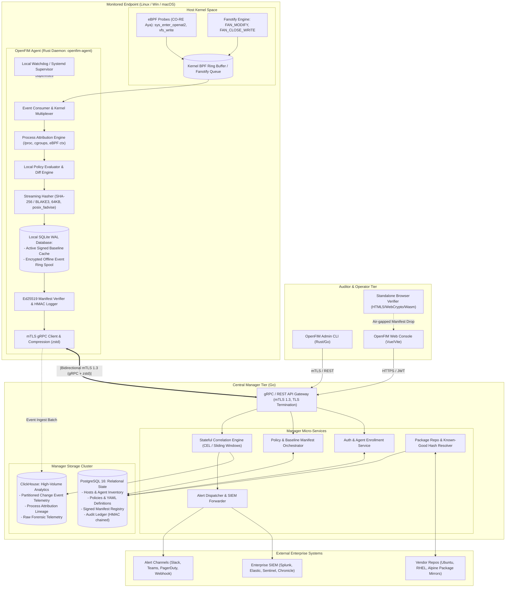
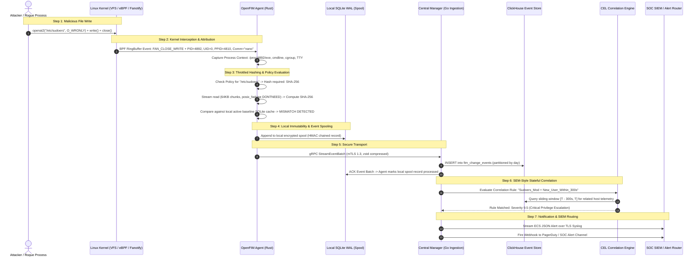

# 3. High-Level Architecture

## 3.1 System Component Architecture

The OpenFIM architecture is divided into three distinct operational domains:
1. **Endpoint Agent (Rust)**: High-performance, low-footprint daemon running on monitored targets (bare metal, VMs, Kubernetes worker nodes).
2. **Central Manager Cluster (Go)**: Horizontally scalable ingestion, policy management, baseline orchestration, and correlation platform backed by PostgreSQL and ClickHouse.
3. **Auditor / Operator Tools**: Modern browser-based web console, admin CLI, and an offline zero-upload client-side verifier.

---

## 3.2 End-to-End Data Flow Architecture

The data flow diagram below traces a file tampering event from initial file modification in kernel space to process attribution, cryptographic hashing, local SQLite buffering, central ingestion, sliding-window correlation, and SIEM alerting.

---

## 3.3 Core Design Decisions & Trade-Offs

1. **Rust for Endpoint Agent**:
   - *Rationale*: Zero runtime garbage collection avoids unpredictable memory and CPU latency spikes on production database/web servers, while memory safety prevents buffer overflows in untrusted file parsers.
   - *Alternative Rejected*: C/C++ (high risk of memory corruption vulnerabilities in daemons running as root); Go (higher resident memory footprint >35MB and runtime GC jitter).
2. **Go for Central Manager**:
   - *Rationale*: Excellent native gRPC/Protobuf concurrency, rapid development velocity, mature cloud-native ecosystem, and simple single-binary deployment for the backend services.
   - *Alternative Rejected*: Java/Spring (heavyweight enterprise footprint like SolarWinds SEM); Python (insufficient throughput for 10k events/sec ingestion).
3. **Hybrid PostgreSQL + ClickHouse Manager Datastore**:
   - *Rationale*: PostgreSQL excels at ACID-compliant relational asset registries, user permissions, and signed baseline manifest storage, while ClickHouse delivers sub-second analytical querying across billions of change events with 5x-10x zstd compression.
   - *Alternative Rejected*: Pure PostgreSQL (struggles with index bloat and high write throughput at 10,000 events/sec sustained); Elasticsearch (resource-intensive JVM cluster requiring substantial RAM).
4. **Local SQLite WAL for Agent Offline Spooling**:
   - *Rationale*: SQLite in Write-Ahead Log (WAL) mode provides crash-resilient local persistence, low CPU overhead (<5MB memory), and zero daemon maintenance for disconnected operation.
   - *Alternative Rejected*: Flat JSON log spooling (susceptible to file truncation on power loss); Redis/RocksDB (excessive binary bloat and memory footprint).
5. **gRPC over mTLS 1.3 Transport**:
   - *Rationale*: Strict bidirectional authentication with client certificate pinning, HTTP/2 multiplexing, compact Protobuf binary serialization, and built-in streaming backpressure.
   - *Alternative Rejected*: Unencrypted syslog/UDP (vulnerable to eavesdropping and packet loss); Custom proprietary TCP framing (high development and maintenance overhead).
