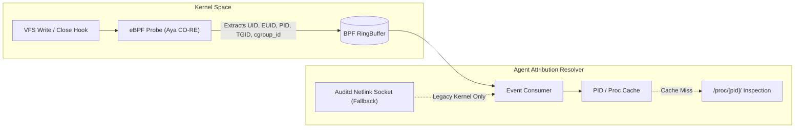

# 4. Agent Design

The OpenFIM endpoint agent (`openfim-agent`) is an ultra-low-overhead, memory-safe daemon implemented in Rust. It operates as an autonomous sensor capable of real-time kernel interception, background verification sweeps, offline spooling, and cryptographic self-defense.

---

## 4.1 Scan Modes & Kernel Interception

```
+-----------------------------------------------------------------------------------------+
|                                    SCAN MODE TAXONOMY                                   |
+-----------------------------------------------------------------------------------------+
| 1. On-Boot Sweep         | Verified against Ed25519 manifest prior to network connect.  |
| 2. Real-Time (Continuous)| Instant kernel interception via eBPF / Fanotify / ETW.        |
| 3. Incremental Sweep     | Rapid stat() metadata comparison against SQLite baseline.     |
| 4. Full Deep Sweep       | Periodic byte-for-byte cryptographic hash re-calculation.    |
+-----------------------------------------------------------------------------------------+
```

### 1. On-Boot Baseline Sweep
- **Trigger**: Executed immediately when `openfim-agent` initializes during system startup (via systemd unit ordering `After=local-fs.target Before=network.target`).
- **Mechanism**: Verifies the digital signature of the active manifest (`manifest.sig`), loads baseline records into the local SQLite memory-mapped cache, and performs a fast stat check across all critical system binaries (`/bin`, `/sbin`, `/usr/bin`, `/boot`).
- **Purpose**: Detects any offline tampering performed while the machine was powered down, rebooted into single-user mode, or mounted via external live ISOs.

### 2. Real-Time Kernel Interception Architecture

| OS Platform | Primary Mechanism | Fallback Mechanism | Kernel Event Hooks |
|---|---|---|---|
| **Linux (Modern 5.8+)** | **eBPF CO-RE Probes** (via Aya framework) | Fanotify filesystem marks | `security_file_permission`, `vfs_write`, `sys_enter_openat2`, `sys_enter_unlinkat`, `sys_enter_renameat2` |
| **Linux (Legacy 4.19+)** | **Fanotify Subsystem** (`FAN_CLASS_NOTIF`) | Inotify directory watches | `FAN_MODIFY`, `FAN_CLOSE_WRITE`, `FAN_ATTRIB`, `FAN_MOVE`, `FAN_DELETE`, `FAN_CREATE` |
| **Windows (Phase 2)** | **USN Change Journal + ETW** | `ReadDirectoryChangesW` | `Microsoft-Windows-Kernel-File`, `FileCreate`, `FileDelete`, `FileModify`, USN Reason Flags |
| **macOS (Phase 2)** | **Endpoint Security (ES) Framework** | FSEvents API | `ES_EVENT_TYPE_NOTIFY_WRITE`, `ES_EVENT_TYPE_NOTIFY_UNLINK`, `ES_EVENT_TYPE_NOTIFY_RENAME` |

#### Linux Kernel Queue Overflow Handling
Kernel event buffers (such as inotify and fanotify) operate with fixed queue depths (`/proc/sys/fs/inotify/max_queued_events`, typically 16,384). Under malicious event flooding (e.g., an attacker creating 100,000 files in `/tmp` to induce buffer starvation) or heavy disk I/O, the kernel emits an overflow notification:
- **Fanotify**: Emits `FAN_Q_OVERFLOW`.
- **Inotify**: Emits `IN_Q_OVERFLOW`.

**OpenFIM Adaptive Overflow Recovery Strategy**:
1. When `FAN_Q_OVERFLOW` is received on the notification file descriptor, the agent immediately sets an internal atomic state flag: `KERNEL_EVENT_LOSS_DETECTED = true`.
2. Emits a high-priority warning event to the manager and local spool: `FIM_KERNEL_OVERFLOW_ANOMALY`.
3. Pauses the real-time consumer to drain the backlogged channel.
4. Spawns an asynchronous **Targeted Reconciliation Sweep**: walks the paths monitored under the saturated fanotify group, performing a fast stat-diff against SQLite. Any file whose `ctime` or `size` diverged from the baseline is queued for re-hashing.
5. Dynamically requests a larger event buffer size (`fanotify_init(FAN_CLASS_NOTIF | FAN_UNLIMITED_QUEUE, ...)`) if running with `CAP_SYS_ADMIN`.

---

## 4.2 Who-Data Attribution Architecture

A file change alert lacking process context is often unactionable for a SOC analyst. OpenFIM implements an **Adaptive Attribution Engine** that correlates every file mutation with the operating system process that executed it.



### eBPF Attribution Mechanics (Linux 5.8+)
Using the Aya Rust eBPF library, OpenFIM attaches lightweight probes to `sys_enter_openat2` and `vfs_write`:
- **Captured in Kernel Space**:
  - `bpf_get_current_uid_gid()`: Real UID and GID.
  - `bpf_get_current_pid_tgid()`: Thread ID and Process ID.
  - `bpf_get_current_cgroup_id()`: Identifies the exact Docker / Kubernetes container pod.
  - `bpf_get_current_comm()`: The executable name (16-byte buffer).
- **Enriched in Agent User Space**:
  - Reads `/proc/<pid>/exe` via `readlink` to obtain the fully qualified binary path (e.g., `/usr/bin/python3.11`).
  - Reads `/proc/<pid>/cmdline` to capture exact command arguments (e.g., `python3 exploit.py`).
  - Reads `/proc/<pid>/status` to capture `PPID` (Parent Process ID) and `loginuid` (the original audit login UID, surviving `sudo` or `su`).
  - Identifies active terminal (`/proc/<pid>/fd/0` pointing to `/dev/pts/X`).

### Attribution Performance & Overhead Comparison

| Attribution Mechanism | CPU Overhead | Memory Overhead | Drop Rate Under Heavy Load | Legacy Kernel Support |
|---|---|---|---|---|
| **OpenFIM eBPF RingBuffer** | **< 0.8% CPU** | **< 4 MB** | **0% (Wait-free ring buffer)** | Linux >= 5.8 (CO-RE) |
| **Linux Auditd Netlink** | 4.5% - 8.2% CPU | 12 - 25 MB | High (Socket queue saturation drops logs) | Universal (Linux 2.6+) |
| **Procfs Polling (`/proc`)** | 2.0% - 5.0% CPU | ~2 MB | Severe (Short-lived processes exit before check) | Universal |

*Rationale for eBPF*: Negligible overhead, zero kernel-space allocations, and immunity to netlink socket dropping under compiler or package upgrade bursts. *Alternative rejected*: Exclusive Auditd netlink socket (causes severe performance degradation and conflicts with host `auditd`).

---

## 4.3 Streaming Cryptographic Hasher

Hashing multi-gigabyte files or scanning thousands of binaries can easily monopolize CPU cores and starve host applications of disk I/O. OpenFIM implements a bounded, non-intrusive streaming hasher in Rust.

```rust
// Architectural snippet: Bounded, Page-Cache-Friendly Hasher (Rust)
use std::fs::File;
use std::io::{Read, Result};
use std::os::unix::fs::MetadataExt;
use std::os::unix::io::AsRawFd;
use sha2::{Digest, Sha256};

const HASH_BUFFER_SIZE: usize = 64 * 1024; // 64 KB bounded memory window

pub struct StreamHasher {
    rate_limiter: TokenBucket, // Throttles MB/sec to respect I/O budget
}

impl StreamHasher {
    pub fn hash_file_safe(&mut self, path: &std::path::Path) -> Result<(String, u64)> {
        let mut file = File::open(path)?;
        let raw_fd = file.as_raw_fd();
        let initial_meta = file.metadata()?;
        
        // POSIX_FADV_DONTNEED: Prevent scanned file bytes from polluting the OS page cache
        unsafe {
            libc::posix_fadvise(raw_fd, 0, 0, libc::POSIX_FADV_DONTNEED);
        }

        let mut hasher = Sha256::new();
        let mut buffer = [0u8; HASH_BUFFER_SIZE];
        let mut total_bytes_read = 0u64;

        loop {
            // Apply token bucket rate limiting (e.g. max 20 MB/s during full background sweep)
            self.rate_limiter.consume(HASH_BUFFER_SIZE);

            let bytes_read = file.read(&mut buffer)?;
            if bytes_read == 0 {
                break;
            }
            hasher.update(&buffer[..bytes_read]);
            total_bytes_read += bytes_read as u64;
        }

        // Post-hashing TOCTOU validation: Ensure file was not swapped during read
        let post_meta = file.metadata()?;
        if initial_meta.ino() != post_meta.ino() || initial_meta.dev() != post_meta.dev() {
            return Err(std::io::Error::new(
                std::io::ErrorKind::Other,
                "TOCTOU Inode Substitution Detected during hash stream"
            ));
        }

        let hash_hex = format!("{:x}", hasher.finalize());
        Ok((hash_hex, total_bytes_read))
    }
}
```

### Hashing Design Specifications
1. **Algorithms**:
   - **SHA-256 (Default)**: Standard cryptographic integrity seal mandated for compliance (PCI DSS, NIST SI-7).
   - **BLAKE3 (Optional / High-Throughput)**: Provides SIMD acceleration (up to 4+ GB/sec on modern AVX-512 hardware) for ultra-large files and container images.
   - **MD5 & SHA-1**: Flagged as cryptographically deprecated; the engine will refuse to accept policies relying solely on MD5/SHA-1.
2. **Page Cache Protection (`POSIX_FADV_DONTNEED`)**:
   - Standard tools like `sha256sum` read files through the kernel page cache, displacing active database pages and application memory. OpenFIM issues `posix_fadvise(..., POSIX_FADV_DONTNEED)` so the kernel discards streamed pages immediately upon hashing.
3. **CPU Niceness & Priority**:
   - The background worker threads run with POSIX `nice(10)` or `SCHED_IDLE`, ensuring that production web/database processes always preempt FIM hashing routines.

---

## 4.4 Metadata Tracking Specification

For every registered entity, the agent captures a 64-byte structured metadata tuple:

```rust
pub struct FileMetadata {
    pub st_dev: u64,          // Device ID (detects cross-device mounts)
    pub st_ino: u64,          // Inode number (detects file replacement)
    pub st_mode: u32,         // File type & UNIX permissions (chmod, SUID, SGID)
    pub st_nlink: u64,        // Hard link count (detects hardlink attacks)
    pub st_uid: u32,          // User ID
    pub st_gid: u32,          // Group ID
    pub st_size: u64,         // Exact file size in bytes
    pub st_mtime: i64,        // Last modification timestamp (seconds)
    pub st_mtime_nsec: i64,   // Modification nanoseconds
    pub st_ctime: i64,        // Last attribute/status change timestamp
    pub st_btime: Option<i64>,// File birth / creation timestamp (statx)
    pub xattrs_hash: String,  // SHA-256 of sorted extended attributes (security.selinux, etc.)
    pub acl_hash: String,     // SHA-256 of POSIX access control lists
    pub symlink_target: Option<String>, // Destination string if entity is a symlink
}
```

### Content vs. Metadata Policy Decoupling
To eliminate the primary driver of false positives in enterprise FIM deployments, OpenFIM enforces granular check masks per monitored path:
- **`check_content_only`**: Monitors byte hash; ignores `mtime`, `atime`, and inode changes. Used for config files touched by backup utilities or NFS filesystems.
- **`check_metadata_only`**: Monitors ownership, mode, and security attributes without hashing file bytes. Used for append-only logs (`/var/log/secure`) and high-volume spools.
- **`check_all`**: Enforces strict hash + metadata identity. Mandatory for static binaries (`/bin/login`, `/usr/sbin/sshd`).

---

## 4.5 Agent Self-Protection & Resilience

1. **Dual Watchdog Supervision**:
   - Integrated with systemd via `sd_notify("WATCHDOG=1")` every 5 seconds (`WatchdogSec=10s` in unit file). If the agent deadlocks or is frozen by an attacker, systemd kills and restarts the process.
   - Secondary standalone supervisor daemon (`openfim-watchdog`) verifies process existence and memory boundaries on non-systemd environments.
2. **Binary Code Signing & Self-Verification**:
   - The compiled agent binary contains an embedded signature block. On startup, the binary reads its own ELF headers and verifies its Ed25519 signature against a hardcoded public key to ensure it was not patched on disk.
3. **Filesystem Immutability**:
   - The agent sets the Linux immutable attribute (`chattr +i`) on its local database directory (`/var/lib/openfim/baseline.db`) and configuration file (`/etc/openfim/agent.yaml`).
4. **Heartbeat Protocol**:
   - The agent transmits an encrypted, signed heartbeat to the manager every 60 seconds. The heartbeat packet contains: `agent_id`, `current_timestamp`, `baseline_manifest_hash`, `memory_rss_bytes`, and `last_processed_sequence_id`.
   - If the manager misses 3 consecutive heartbeats (180s), it generates an immediate Sev-8 alert: `AGENT_SILENCE_ANOMALY (Potential Host Disablement)`.
