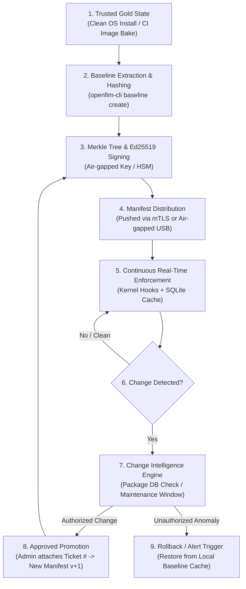

# 6. Baseline & Data Model

The OpenFIM data model bridges edge autonomy on endpoints with high-throughput central analytical reporting.

---

## 6.1 Storage Architecture Rationale

| Layer | Selected Storage Engine | One-Line Architectural Rationale | Main Alternative Rejected |
|---|---|---|---|
| **Agent Local Baseline & Spool** | **SQLite (WAL Mode, rusqlite)** | Provides ACID transactional consistency, rich indexing for diff queries, zero-daemon overhead, and crash recovery. | **LMDB / heed**: Rejected due to higher complexity in managing dynamic multi-column secondary indices and schema migrations. |
| **Manager Relational Inventory** | **PostgreSQL 16** | Proven enterprise relational integrity for agent enrollment, cryptographic manifests, RBAC, and policy definitions. | **MySQL**: Rejected due to weaker JSONB indexing and less capable recursive query/windowing features. |
| **Manager Event Lake & Analytics** | **ClickHouse Columnar Store** | Ingests 100k+ events/sec, delivers sub-second analytical aggregations, and provides 8x-12x zstd data compression on disk. | **Elasticsearch**: Rejected due to massive JVM RAM requirements, heap garbage collection freezes, and higher operational complexity. |

---

## 6.2 Agent Local Database Schema (SQLite 3 WAL Mode)

```sql
-- ============================================================================
-- OPENFIM AGENT LOCAL DATABASE: /var/lib/openfim/baseline.db
-- ============================================================================
PRAGMA journal_mode = WAL;
PRAGMA synchronous = NORMAL;
PRAGMA foreign_keys = ON;

-- Active Baseline File Records
CREATE TABLE IF NOT EXISTS baseline_entries (
    path TEXT PRIMARY KEY NOT NULL,             -- Normalized canonical absolute path
    sha256 TEXT NOT NULL,                        -- Lowercase 64-char SHA-256 hash
    blake3 TEXT,                                 -- Optional BLAKE3 hash
    file_size INTEGER NOT NULL,                  -- Size in bytes
    mode INTEGER NOT NULL,                       -- UNIX st_mode (permissions, file type)
    uid INTEGER NOT NULL,                        -- Owner UID
    gid INTEGER NOT NULL,                        -- Group GID
    inode INTEGER NOT NULL,                      -- File system inode number
    dev INTEGER NOT NULL,                        -- Device identifier
    nlink INTEGER NOT NULL,                      -- Hard link count
    mtime INTEGER NOT NULL,                      -- Modification timestamp (Unix epoch seconds)
    mtime_nsec INTEGER NOT NULL DEFAULT 0,       -- Modification nanoseconds
    ctime INTEGER NOT NULL,                      -- Status change timestamp
    xattrs_hash TEXT,                            -- SHA-256 hash of sorted key=value xattrs
    acl_hash TEXT,                               -- SHA-256 hash of POSIX ACL representation
    symlink_target TEXT,                         -- Target destination if symlink
    manifest_version TEXT NOT NULL,              -- Manifest ID this entry belongs to
    created_at INTEGER NOT NULL                  -- Epoch timestamp of baseline insertion
);

CREATE INDEX IF NOT EXISTS idx_baseline_inode_dev ON baseline_entries(inode, dev);
CREATE INDEX IF NOT EXISTS idx_baseline_hash ON baseline_entries(sha256);

-- Offline Event Spool (Circular Ring Queue for Disconnected Mode)
CREATE TABLE IF NOT EXISTS event_spool (
    sequence_id INTEGER PRIMARY KEY AUTOINCREMENT,
    event_id TEXT UNIQUE NOT NULL,              -- UUIDv4 identifier
    timestamp_nano INTEGER NOT NULL,            -- Nanosecond epoch timestamp
    event_type TEXT NOT NULL,                   -- CREATED | MODIFIED | DELETED | ATTRIB_CHANGED
    path TEXT NOT NULL,                         -- Affected path
    severity INTEGER NOT NULL,                  -- 1 to 10
    whodata_pid INTEGER,                        -- Acting process PID
    whodata_uid INTEGER,                        -- Acting process UID
    whodata_comm TEXT,                          -- Executable name
    whodata_exe TEXT,                           -- Full path to binary
    whodata_cmdline TEXT,                       -- Full CLI invocation
    whodata_cgroup TEXT,                        -- Linux cgroup identifier
    old_sha256 TEXT,                            -- Previous baseline hash
    new_sha256 TEXT,                            -- Current post-change hash
    diff_snippet TEXT,                          -- Redacted text diff (NULL if nodiff: true)
    hmac_signature TEXT NOT NULL,               -- HMAC-SHA256(secret, prev_hmac || event_data)
    sent_to_manager INTEGER NOT NULL DEFAULT 0  -- 0 = buffered; 1 = acknowledged by manager
);

CREATE INDEX IF NOT EXISTS idx_spool_unsent ON event_spool(sent_to_manager, sequence_id);
```

---

## 6.3 Manager Database Schemas

### 1. PostgreSQL Schema: Relational Inventory & Policy Manifests

```sql
-- Monitored Host Registry
CREATE TABLE hosts (
    host_id UUID PRIMARY KEY DEFAULT gen_random_uuid(),
    hostname VARCHAR(255) NOT NULL,
    ip_address INET NOT NULL,
    os_distro VARCHAR(64) NOT NULL,
    os_kernel VARCHAR(64) NOT NULL,
    agent_version VARCHAR(32) NOT NULL,
    enrolled_at TIMESTAMPTZ NOT NULL DEFAULT NOW(),
    last_heartbeat TIMESTAMPTZ NOT NULL,
    status VARCHAR(32) NOT NULL DEFAULT 'ACTIVE', -- ACTIVE | DISCONNECTED | ISOLATED
    active_manifest_id UUID,
    mtls_cert_fingerprint VARCHAR(64) UNIQUE NOT NULL
);

-- Cryptographically Signed Baseline Manifests
CREATE TABLE baseline_manifests (
    manifest_id UUID PRIMARY KEY DEFAULT gen_random_uuid(),
    host_id UUID REFERENCES hosts(host_id) ON DELETE CASCADE,
    version_tag VARCHAR(64) NOT NULL,           -- e.g. "v1.0.0-gold-master"
    entry_count INTEGER NOT NULL,
    merkle_root_hash CHAR(64) NOT NULL,         -- SHA-256 Merkle root of all path+hash tuples
    ed25519_signature BYTEA NOT NULL,           -- Signature over merkle_root_hash + metadata
    signed_by_key_id VARCHAR(64) NOT NULL,      -- Key ID of security officer / CI pipeline
    created_at TIMESTAMPTZ NOT NULL DEFAULT NOW(),
    manifest_payload_zstd BYTEA NOT NULL        -- Compressed JSON/CBOR manifest data
);

-- Tamper-Evident Audit Ledger (Append-Only)
CREATE TABLE audit_ledger (
    entry_id BIGSERIAL PRIMARY KEY,
    timestamp TIMESTAMPTZ NOT NULL DEFAULT NOW(),
    operator_id VARCHAR(128) NOT NULL,          -- Username or CI service account
    action_type VARCHAR(64) NOT NULL,           -- BASELINE_PROMOTED | POLICY_UPDATED | ALERT_ACK
    target_entity VARCHAR(255) NOT NULL,        -- host_id or policy_id
    change_justification TEXT NOT NULL,         -- Required ticket ID or change reference (e.g. JIRA-4091)
    previous_record_hash CHAR(64) NOT NULL,     -- Hash chain link
    record_hash CHAR(64) NOT NULL               -- SHA256(previous_record_hash || timestamp || action || ...)
);
```

### 2. ClickHouse Schema: High-Volume Change Event Telemetry

```sql
CREATE TABLE default.fim_change_events (
    event_time DateTime64(3, 'UTC'),
    event_id UUID,
    host_id UUID,
    hostname LowCardinality(String),
    event_type LowCardinality(String),         -- CREATED, MODIFIED, DELETED, ATTRIB
    path String,
    parent_dir LowCardinality(String),
    severity UInt8,
    file_size UInt64,
    old_sha256 FixedString(64),
    new_sha256 FixedString(64),
    is_package_update UInt8,                   -- 1 if verified against dpkg/rpm; 0 otherwise
    pid UInt32,
    ppid UInt32,
    uid UInt32,
    euid UInt32,
    comm LowCardinality(String),
    exe String,
    cmdline String,
    cgroup String,
    container_id LowCardinality(String)
) ENGINE = MergeTree()
PARTITION BY toYYYYMM(event_time)
ORDER BY (event_type, severity, host_id, event_time)
TTL event_time + INTERVAL 365 DAY;
```

---

## 6.4 Baseline Lifecycle Management



### Baseline Creation, Promotion, & Diffing Logic
1. **Creation**:
   - The CLI or agent traverses monitored paths defined in policy.
   - For every file, calculates SHA-256 and records the 64-byte metadata tuple.
   - Sorts records alphabetically by normalized path to create a deterministic Merkle tree.
   - Signs the Merkle root hash with the operator's Ed25519 private key.
2. **Approved Change Promotion**:
   - When a legitimate software upgrade occurs (e.g., scheduled deployment), the change event is inspected.
   - The security operator triggers `openfim-cli baseline promote --host <id> --ticket "CHG-8910"`.
   - The manager generates an incremental manifest version (e.g. `v1.0.1`), updates PostgreSQL, records the approval in the append-only `audit_ledger`, and dispatches the signed delta to the agent.
3. **Rollback**:
   - If an unauthorized change is flagged, the operator or automated active response can issue a rollback command.
   - The agent retrieves the pristine file copy from its local signed baseline cache (`/var/lib/openfim/cache/<sha256>`) and restores it atomically via `renameat2(RENAME_EXCHANGE)`.
4. **Two-Way Diffing Algorithm**:
   - Diffing between Baseline $A$ and Baseline $B$ performs an in-memory two-pointer scan over the sorted path indices in $O(N)$ time, immediately emitting `ADDED`, `REMOVED`, `MODIFIED_CONTENT`, or `MODIFIED_METADATA` records.
