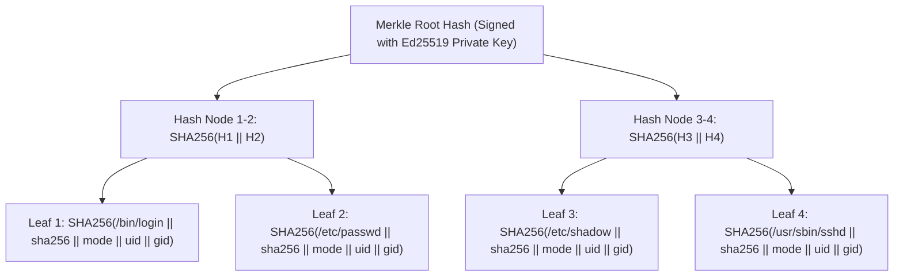

# 7. Tamper-Evidence & Cryptography

The OpenFIM cryptographic architecture provides end-to-end mathematical guarantees that baselines cannot be silently altered, logs cannot be truncated without detection, and communication cannot be intercepted or replayed.

---

## 7.1 Cryptographic Primitives & Schemes

| Domain | Cryptographic Primitive | Key Size / Spec | Purpose & Implementation |
|---|---|---|---|
| **Baseline Signing** | **Ed25519** (RFC 8032) | 256-bit key (Edwards curve 25519) | Signs the Merkle root of baseline manifests; high verification speed, deterministic signatures. |
| **Integrity Hashing** | **SHA-256** (FIPS 180-4) | 256-bit digest | Primary compliance hash for file content, metadata serialization, and Merkle tree leaves. |
| **High-Speed Hashing** | **BLAKE3** | 256-bit digest, tree-structured | Accelerated SIMD hashing for large binaries (>100MB) and container layers. |
| **Append-Only Logging** | **HMAC-SHA256** | 256-bit key | Chains local offline spool records: each entry commits to the cryptographic hash of the preceding entry. |
| **Transport Security** | **TLS 1.3 with mTLS** | ECDHE-ECDSA-AES256-GCM-SHA384 | Bidirectional mutual authentication between agent and manager; certificate pinning on client. |
| **Hardware Root of Trust**| **TPM 2.0 / Enclave** | PCR[7], PCR[8], PCR[14] | Seals agent local signing key and baseline encryption keys to valid hardware platform state. |

---

## 7.2 Merkle-Tree Baseline Manifests

Rather than signing each individual file record (which generates thousands of signature verifications), the agent compiles the baseline entries into a deterministic **Merkle Tree**:

### Verification Properties:
1. **$O(1)$ Manifest Authentication**: The agent verifies a single Ed25519 signature over the Merkle Root Hash on startup.
2. **$O(\log N)$ Inclusion Proofs**: When verifying a single file on-demand, the agent can cryptographically prove that the file belongs to the certified baseline without loading all 100,000 files into memory.

---

## 7.3 Append-Only HMAC-Chained Event Log

When an agent operates disconnected from the manager, it buffers change events in the local SQLite `event_spool` table. To prevent a root-level attacker from retroactively deleting or altering specific change rows, every entry is cryptographically chained:

$$\text{HMAC}_n = \text{HMAC-SHA256}\Big(K_{\text{agent}}, \;\; \text{HMAC}_{n-1} \;\|\; \text{Seq}_n \;\|\; \text{Timestamp}_n \;\|\; \text{Path}_n \;\|\; \text{NewHash}_n\Big)$$

- **Chain Verification**: On reconnect, the central manager verifies the HMAC sequence sequentially.
- **Tamper Detection**: If an adversary alters any field in record $k$ or deletes record $k$, the HMAC of all subsequent records $k+1 \dots n$ will fail validation, immediately flagging: `TAMPERED_OFFLINE_LOG_DETECTED`.

---

## 7.4 Mutual TLS 1.3 Transport & Replay Protection

Communication between `openfim-agent` and the central manager runs strictly over **gRPC over mutual TLS 1.3**:
1. **Client Authentication**: Each agent is provisioned with a unique X.509 client certificate generated during initial enrollment.
2. **Certificate Pinning**: The agent binary embeds the Root CA certificate and pins the public key of the central manager cluster, preventing TLS interception by transparent corporate proxies or rogue CAs.
3. **Replay Protection**:
   - Every telemetry batch includes: `agent_id`, an incrementing monotonic 64-bit `sequence_number`, a nanosecond UTC `timestamp`, and a 128-bit cryptographically secure `nonce`.
   - The manager tracks the highest sequence number per agent in PostgreSQL. Any message with an identical or retrograde sequence number is rejected and logged as a replay attack.

---

## 7.5 TPM 2.0 & Hardware Root-of-Trust Binding (Optional Enclave)

On platforms equipped with a Trusted Platform Module (TPM 2.0):
1. **Key Sealing**: The agent's local HMAC key and private client identity key are sealed to TPM Platform Configuration Registers:
   - `PCR[0]`: Core System Firmware (UEFI)
   - `PCR[7]`: Secure Boot state
   - `PCR[14]`: Kernel cmdline & OpenFIM binary hash
2. **Unsealing Failure**: If an attacker reboots the machine with `init=/bin/sh`, disables Secure Boot, or boots into a live Linux USB, the TPM refuses to unseal the agent keys, preventing the attacker from generating valid signatures or decrypting the local baseline cache.

---

## 7.6 Threat Impact: Blast Radius of Manager Compromise

What happens if an adversary compromises the central FIM manager?

| Adversary Action on Compromised Manager | Impact on Managed Agents | Containment Mechanism |
|---|---|---|
| **Injecting Malicious Baseline Manifest** | **Zero Impact (Blocked)** | Baseline manifests must be signed with an offline Ed25519 private key (held on an air-gapped security workstation or HSM). The manager holds public keys only; it cannot forge valid manifests. |
| **Pushing Malicious Agent Binary Update** | **Zero Impact (Blocked)** | Binary updates require dual digital signatures (developer release key + security officer key). Agents reject unsigned binaries. |
| **Pushing Malicious Detection Policy** | **Zero Impact (Blocked)** | Policy YAML bundles are cryptographically signed. Unsigned or modified policies are rejected by agents. |
| **Suppressing Alerts / Dropping Logs** | **Partial (Temporary)** | The manager can drop incoming telemetry, blinding SOC dashboards. However, agents continue logging locally to immutable append-only spools. Independent agent heartbeat monitors outside the manager flag the disconnection. |
