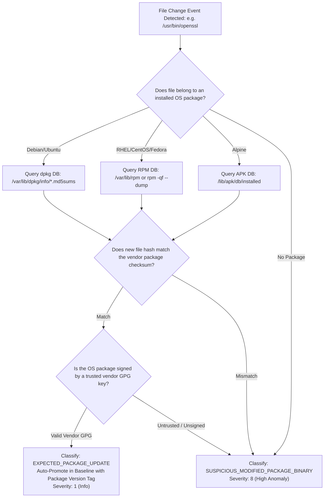

# 8. Change Intelligence & False-Positive Reduction

The #1 operational failure mode of traditional FIM systems is alert fatigue: routine OS security updates (`apt-get upgrade`, `dnf update`) touch thousands of files, triggering thousands of high-priority alerts that flood the SOC. OpenFIM introduces an automated **Change Intelligence Engine** to distinguish authorized administrative updates from genuine intrusions.

---

## 8.1 Change Classification Model

OpenFIM categorizes every filesystem mutation into a three-tier classification taxonomy:

```
+-----------------------------------------------------------------------------------------+
|                              CHANGE CLASSIFICATION MODEL                                |
+-----------------------------------------------------------------------------------------+
| [EXPECTED]   | Verified vendor package update, signed CI/CD deployment, or authorized   |
|              | change window with matching ticket. Auto-promoted to baseline.           |
+--------------+--------------------------------------------------------------------------+
| [SUSPICIOUS] | File modified outside change window, unverified package hash, or         |
|              | interactive admin shell editing a non-critical configuration file.       |
+--------------+--------------------------------------------------------------------------+
| [CRITICAL]   | Unauthorized binary modification, /etc/shadow tampering, webshell drop,  |
|              | SUID bit addition, or file modification attributed to unprivileged UID.  |
+-----------------------------------------------------------------------------------------+
```

---

## 8.2 Package Manager Verification Engine

When a monitored binary or system configuration file under `/usr`, `/bin`, `/lib`, or `/etc` is modified, the agent executes an in-process verification against the operating system's native package database.



### Implementation Details:
1. **Zero CLI Spawning**: Rather than executing expensive subshells (`fork/exec` of `dpkg -S`), the agent directly inspects memory-mapped package metadata files on Debian/Ubuntu (`/var/lib/dpkg/status` and `/var/lib/dpkg/info/<pkg>.md5sums`) or links to `librpm` on Red Hat systems.
2. **Vendor Signature Verification**: A binary is only classified as `EXPECTED` if the containing package was installed from a cryptographically verified GPG repository key registered in the system trust store.

---

## 8.3 Authorized Change Windows & CI/CD Integration

1. **Time-Bounded Maintenance Windows**:
   - The central manager exposes an API endpoint: `POST /api/v1/maintenance-windows`.
   - Security operators define maintenance windows scoped by host, path pattern, and duration (e.g., Host `web-prod-01`, Path `/var/www/html/**`, Window `2026-10-19 02:00 to 04:00 UTC`, Ticket `CHG-9821`).
   - Changes occurring during active windows are tagged with the ticket ID and suppressed from generating high-urgency pager alerts, while remaining fully recorded in the audit ledger.
2. **CI/CD Webhook Integration**:
   - Deployment pipelines (GitHub Actions, GitLab CI, ArgoCD, Jenkins) invoke an authenticated webhook prior to deploying application artifacts:
     ```bash
     curl -X POST https://fim-manager:8443/api/v1/deployments/start \
       --header "Authorization: Bearer $FIM_DEPLOY_TOKEN" \
       --data '{"host_group": "web-cluster", "git_commit": "a4f89b", "ticket": "PROD-402"}'
     ```
   - When the deployment completes, the pipeline pushes the manifest of deployed files, automatically compiling and signing the new baseline manifest.

---

## 8.4 Known-Good Hash Feeds & External Reputation Lookups

1. **NIST National Software Reference Library (NSRL)**:
   - The manager maintains a local Bloom filter / ClickHouse index of the NIST NSRL (Reference Data Set) containing over 100 million cryptographic hashes of known-good, commercial operating system and library files.
   - Any file matching NSRL is verified as standard commercial off-the-shelf software.
2. **Opt-In Threat Intelligence & Hash Feeds**:
   - In environments where privacy and compliance policies permit external lookups, unknown file hashes can be queried against MISP, CIRCL, or private threat intelligence feeds.
   - *Strict Air-Gapped Compliance*: In air-gapped or classified deployments, external lookups are disabled by default (`reputation_lookups.enabled: false`).
