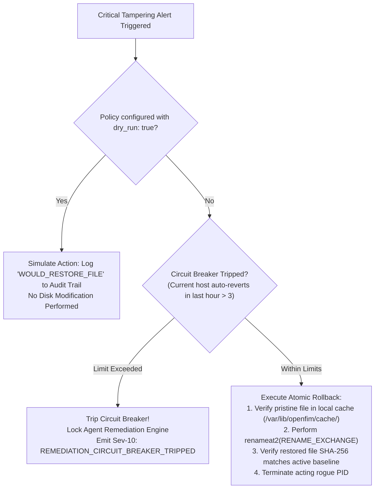

# 9. Event Pipeline, Correlation & Response (SEM-Style)

OpenFIM adapts the high-velocity correlation and automated containment capabilities of enterprise Security Information & Event Management (SEM) systems into an open-source, cloud-native architecture.

---

## 9.1 Normalization Schema (Elastic Common Schema / ECS Compatible)

Every file change event is serialized into an ECS-compliant JSON payload before being ingested into ClickHouse and routed to enterprise SIEMs:

```json
{
  "@timestamp": "2026-10-19T05:34:12.894Z",
  "ecs": { "version": "8.11.0" },
  "event": {
    "id": "c9b2f67e-3a14-4e1b-9f82-a4290d9f0183",
    "category": ["file", "host"],
    "type": ["change", "access"],
    "action": "file_modified",
    "severity": 9,
    "module": "openfim",
    "dataset": "openfim.change_event"
  },
  "host": {
    "id": "6a9e1e2d-41a4-4a25-83e7-1cfd49590891",
    "name": "srv-prod-db-01",
    "ip": ["10.140.20.15"],
    "os": { "family": "debian", "version": "12.5", "kernel": "6.1.0-21-amd64" }
  },
  "file": {
    "path": "/etc/shadow",
    "name": "shadow",
    "directory": "/etc",
    "size": 1420,
    "mode": "0640",
    "owner": "root",
    "group": "shadow",
    "inode": "1049281",
    "hash": {
      "sha256": "e3b0c44298fc1c149afbf4c8996fb92427ae41e4649b934ca495991b7852b855"
    }
  },
  "openfim": {
    "baseline_version": "v1.2.0-gold",
    "previous_hash": "a1b2c3d4e5f60718293a4b5c6d7e8f90123456789abcdef0123456789abcdef0",
    "is_authorized_change": false,
    "package_verified": false
  },
  "process": {
    "pid": 4892,
    "ppid": 4810,
    "name": "nano",
    "executable": "/usr/bin/nano",
    "command_line": "nano /etc/shadow",
    "parent": { "pid": 4810, "name": "bash", "executable": "/bin/bash" }
  },
  "user": {
    "id": "0",
    "name": "root",
    "effective": { "id": "0", "name": "root" },
    "audit": { "id": "1002", "name": "jdoe" }
  }
}
```

---

## 9.2 Stateful Correlation Engine (CEL / Sliding Windows)

SolarWinds SEM’s primary strength is stateful event correlation across time windows. OpenFIM implements this with Google's **Common Expression Language (CEL)** backed by an in-memory sliding time-window state machine in the central manager.

### Example Correlation Rule: Unauthorized Binary Drop + Cron Modification + Outbound Connection

```yaml
correlation_rule:
  id: "CORR-001-PRIV-PERSISTENCE"
  name: "Adversary Persistence & Ingress Drop"
  severity: 10
  window_seconds: 300                 # 5-minute sliding correlation window
  
  stages:
    - id: "stage_1_binary_drop"
      filter: >
        event.category.contains("file") &&
        event.action == "file_created" &&
        file.path.startsWith("/usr/local/bin/") &&
        file.mode.matches(".*7..")    # Executable permissions

    - id: "stage_2_cron_modification"
      filter: >
        event.category.contains("file") &&
        file.path.startsWith("/etc/cron") &&
        process.pid != 0

    - id: "stage_3_network_egress"
      filter: >
        event.category.contains("network") &&
        network.direction == "egress" &&
        destination.port in [4444, 1337, 8443, 9001]

  condition: >
    sequence([stage_1_binary_drop, stage_2_cron_modification, stage_3_network_egress]) &&
    stage_1_binary_drop.host.id == stage_2_cron_modification.host.id

  actions:
    - type: "fire_high_priority_alert"
      channels: ["pagerduty", "soc_slack", "siem_syslog"]
    - type: "dispatch_active_response"
      target_host: "match.host.id"
      response_action: "quarantine_file"
      target_path: "stage_1_binary_drop.file.path"
```

---

## 9.3 SIEM Export & Alert Routing

The Alert Dispatcher pipelines change events to enterprise destinations in parallel:
1. **RFC 5424 TLS Syslog (CEF / JSON)**: Streams real-time alerts to Splunk, LogRhythm, or IBM QRadar.
2. **OpenTelemetry Protocol (OTLP)**: Exports telemetry over gRPC to OpenTelemetry collectors for forward ingestion into Datadog, Dynatrace, or Grafana Loki.
3. **Webhook Notifications**: Emits formatted payloads directly to Slack, Microsoft Teams, and PagerDuty with rich change metadata and direct links to the OpenFIM Diff Viewer.

---

## 9.4 Guarded Active Response Engine

Active remediation (reverting changes, terminating processes) carries operational risk. OpenFIM enforces a **Guarded Remediation Model** to prevent self-inflicted denial-of-service.



### Safety Controls:
1. **Circuit Breakers**: No agent may execute more than 3 automated rollbacks within a rolling 60-minute window without manual operator re-authorization.
2. **Dry-Run Enforcement**: All new active response policies are forced into simulation mode (`dry_run: true`) for an initial 7-day observation period.
3. **Atomic Rollback via `renameat2`**: Rollback uses kernel-level atomic exchange (`renameat2` with `RENAME_EXCHANGE`), eliminating race conditions where a service reads a half-written file.
