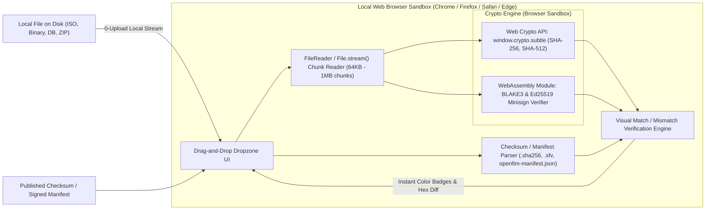

# 10. Client-Side Verifier Module (Jam.dev & Aback Style)

The OpenFIM Client-Side Verifier is a zero-installation, zero-upload web utility inspired by the frictionless user experience of Jam.dev and Aback Tools. It executes entirely inside the user’s browser sandbox using standard Web APIs, ensuring sensitive proprietary binaries and system files are never uploaded across the network.

---

## 10.1 Architecture & Security Properties



### Key Security & Architectural Properties:
1. **Zero-Upload Guarantee**: The application makes zero outbound HTTP POST or WebSocket calls with file bytes. Files of arbitrary size (tested up to 50 GB) are streamed directly from local disk into the browser's crypto engine via `File.stream().getReader()`.
2. **Offline & Air-Gapped Autonomy**: Packaged as a single standalone HTML file (`verifier.html`) with inline CSS and JavaScript. An auditor can double-click this file on an air-gapped forensic workstation without running a local web server.
3. **Cross-Format Support**: Automatically parses and validates:
   - GNU/BSD `.sha256` and `.sha512` digests (`<hash>  <filename>`)
   - Traditional `.md5` checksums
   - Simple File Verification (`.sfv`) CRC32 tables
   - Cryptographically signed OpenFIM baseline manifests (`manifest.json` + `manifest.sig`)

---

## 10.2 Shared Baseline Manifest Schema

The client-side verifier shares the exact deterministic manifest format generated by the Rust agent and Central Manager:

```json
{
  "manifest_version": "1.0",
  "generated_at": "2026-10-19T05:00:00Z",
  "hostname": "prod-master-01",
  "policy_id": "pol-linux-pci-baseline",
  "merkle_root": "6a9e1e2d41a44a2583e71cfd4959089182374618234612349817234918237491",
  "signature": {
    "algorithm": "ed25519",
    "public_key_id": "key-secops-release-2026",
    "sig_hex": "e1f9a2b3...d4c5"
  },
  "files": [
    {
      "path": "/bin/login",
      "sha256": "8f434346648f6b96df89dda901c5176b10a6d83961dd3c1ac88b59b2dc327aa4",
      "size": 58448,
      "mode": "0755",
      "uid": 0,
      "gid": 0
    },
    {
      "path": "/etc/shadow",
      "sha256": "e3b0c44298fc1c149afbf4c8996fb92427ae41e4649b934ca495991b7852b855",
      "size": 1420,
      "mode": "0640",
      "uid": 0,
      "gid": 42
    }
  ]
}
```

---

## 10.3 Streaming Web Crypto Implementation Details

Computing the SHA-256 hash of a 10 GB file in the browser without crashing the tab requires streaming chunks through an incremental digest. Since the native browser `crypto.subtle.digest` API historically processes single contiguous ArrayBuffers, OpenFIM utilizes a two-tier approach:
1. **Files < 500 MB**: Handled directly via `crypto.subtle.digest('SHA-256', buffer)`.
2. **Files >= 500 MB**: Streamed in 1 MB chunks through a compiled, zero-dependency WebAssembly (Wasm) cryptographic core compiled from Rust (`wasm-bindgen` with `sha2` and `blake3`), maintaining a constant memory ceiling of under 10 MB RAM regardless of file size.
3. **Minisign & Ed25519 Verification**: Signature verification is executed locally via pure JavaScript / Wasm Ed25519 verification against a user-pasted or trusted embedded public key.
