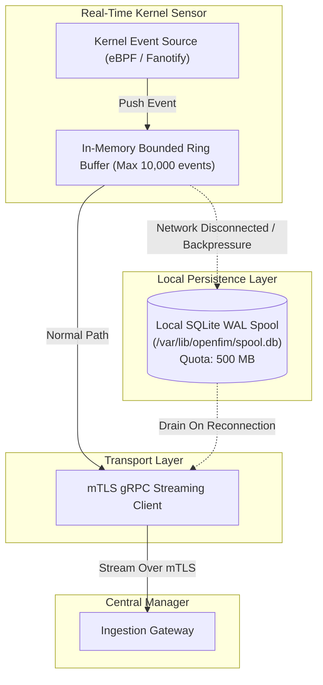

# 13. Performance, Scale & Reliability

OpenFIM is engineered to operate on mission-critical production servers where performance overhead and memory instability are unacceptable.

---

## 13.1 Performance Budgets & Resource Envelopes

| Metric | Idle Real-Time Monitoring | Full Deep Cryptographic Crawl (100k files) | Hard Ceiling / Enforcement |
|---|---|---|---|
| **Resident Memory (RSS)** | **< 12 MB** | **< 32 MB** | 50 MB hard limit enforced via `MemoryMax=64M` in systemd. |
| **CPU Utilization** | **< 0.5% of 1 core** | **< 4.5% of 1 core** | CPU quota enforced via `CPUQuota=10%` and `nice(10)`. |
| **Disk Read Throughput** | 0 MB/s (kernel event driven) | Throttled to 20 MB/s | Token bucket rate limiter restricts I/O bandwidth. |
| **Page Cache Impact** | 0 bytes evicted | 0 bytes evicted | Mandatory `posix_fadvise(..., POSIX_FADV_DONTNEED)`. |
| **Network Egress (Idle)** | < 1.5 KB / minute | Streamed event batches | zstd compression reduces payload sizes by >75%. |

---

## 13.2 Scale Architecture & Sizing for 5,000 Endpoints

```
+-----------------------------------------------------------------------------------------+
|                         5,000 ENDPOINT DEPLOYMENT SIZING PROFILE                        |
+-----------------------------------------------------------------------------------------+
| Average Events / Endpoint / Day : 500 events (routine baseline drift + log rotations)   |
| Peak Events / Endpoint / Hour   : 5,000 events (during mass automated package patching) |
| Total Fleet Daily Ingestion     : 2,500,000 events / day (approx. 29 events/sec steady) |
| Peak Ingestion Burst (Fleet)    : 7,500 events / second sustained for 30 minutes        |
+-----------------------------------------------------------------------------------------+
```

### Central Infrastructure Sizing Guidelines:
1. **Manager Ingestion Layer (Go)**:
   - 2x Load-balanced Manager Nodes: 4 vCPU, 8 GB RAM each.
   - Handles gRPC connection termination, TLS offloading, and Cel correlation.
2. **Relational Database (PostgreSQL 16)**:
   - 1x Primary Instance: 4 vCPU, 16 GB RAM, 200 GB NVMe SSD.
   - Houses 5,000 host records, policy manifests, RBAC, and append-only audit ledger.
3. **Event Lake (ClickHouse)**:
   - 1x Analytical Node: 8 vCPU, 32 GB RAM, 1 TB NVMe SSD.
   - Ingests 2.5 million events/day. With ClickHouse columnar zstd compression, each change event occupies ~120 bytes on disk:
     $$\text{Daily Storage} = 2,500,000 \times 120 \text{ bytes} \approx 300 \text{ MB / day}$$
     $$\text{Annual Storage (1 Year Retention)} \approx 110 \text{ GB}$$

---

## 13.3 Backpressure, Offline Buffering & Failure Modes



### Failure Mode Handling:
1. **Network Partition / Manager Outage**:
   - The agent switches immediately to **Autonomous Offline Spooling**.
   - Events are committed to the local SQLite `event_spool` table with cryptographic HMAC chaining.
   - The spool buffer is capped at a configurable disk quota (default: 500 MB). If disk quota reaches 95%, non-critical informational file access events are dropped first, preserving critical privilege and binary change events.
2. **Local Disk Space Exhaustion**:
   - The agent checks free filesystem space before allocating spool records. If disk space drops below 5%, the agent suspends disk writes and logs a priority warning event to the system log (`/dev/log`).
3. **Kernel Buffer Overflow Storms**:
   - If an attacker or script generates 500,000 events in 3 seconds, `FAN_Q_OVERFLOW` triggers a graceful shift from real-time streaming to a throttled background reconciliation crawl, preventing agent crashes.
